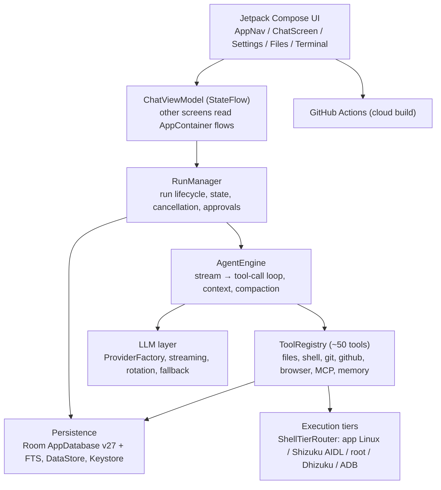
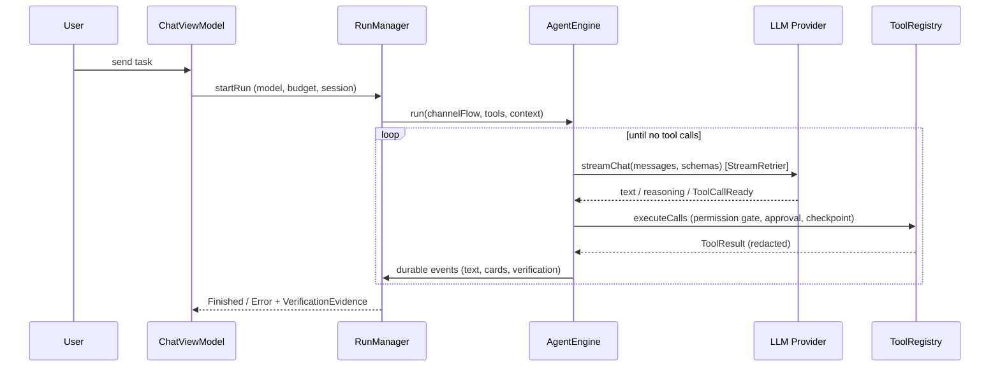

# HMXHARNESS Architecture

## 1. High-level architecture

## 2. Application composition

- `HarnessApp : Application` — installs `GpuDeliveryFactory`, `StorageGate`, creates `AppContainer`, reschedules reminders; low-memory handler releases local models.
- `AppContainer` — the manual DI/service locator: constructs `SettingsRepository`, `ProviderRepository`, `SessionRepository`, `MemoryRepository`, `AgentEngine`, `RunManager`, `WorkspaceManager`, `ToolRegistry`, `McpManager`, `LinuxEnvironmentManager`, privileged managers, GitHub/Telegram/FTP managers.
- `MainActivity` — single launcher activity: Compose host, share target (`ShareToChat` alias), MCP OAuth callback (`hmxharness://mcp`), biometric lock, `FLAG_SECURE`.
- Services: `AgentService` (foreground run host + notification actions), `FtpShareService`, `AdbPairingService`, `WirelessAdbService`, `TelegramService`; receivers for notifications, automation, reminders, ADB reconnect, Telegram boot.
- AIDL: `IHarnessService.aidl` implemented by `HarnessUserService` (loaded in Shizuku server) and `RootHarnessService` (libsu) for privileged shell/file ops.

## 3. Agent execution flow

Key classes: `AgentEngine.run`, `RunManager.handleEvent`, `TaskControlStore`, `RetryPolicy`, `StreamRetrier`, `FallbackProvider`, `HistoryCompactor`, `ContextHygiene`, `VerificationEvidence`.

## 4. Tool pipeline

`Tool` interface (`name`, `description`, JSON schema, `isReadOnly`, `execute`) → `ToolRegistry.default(...)` → `AgentEngine.executeCalls` →
`executeWithFailureGuard` → `executeWithPermission` (PLAN mode, plugin hooks, policy, approval `CompletableDeferred`, pre-edit checkpoint) →
`WorkspaceToolRouting.route` → `Tool.execute`. Outputs pass through `SecretRedactor` before model/UI/DB.

## 5. Persistence

- `AppDatabase` (v27): sessions, messages, projects, work projects, checkpoints, snippets, usage events, file edits, code activity, FTS4 message index, memory, answer versions, saved answers.
- `DebugLogDatabase` (v2) with encrypted trace bodies.
- DataStore: settings, providers, voice providers, device access.
- Keystore: `EncryptedSharedPreferences(api_keys.xml)` with AES256_SIV keys / AES256_GCM values — API keys, GitHub token, MCP OAuth state, voice/search keys.
- Workspaces: app-private root, SAF folders, SSH (JSch), or unbounded only in FULL_ACCESS.

## 6. Identity / branding surface (changed in HMX)

| Surface | Old | New |
|---|---|---|
| Application ID / namespace / Kotlin package | `com.androidharness.app` | `com.hmx.harness` |
| Debug application ID | `com.androidharness.app.debug` | `com.hmx.harness.debug` |
| Theme | `Theme.AndroidHarness` | `Theme.HMXHARNESS` |
| Deep-link / OAuth redirect scheme | `androidharness://mcp` | `hmxharness://mcp` |
| App label / share target | AndroidHarness | HMXHARNESS |
| JNI symbols | `Java_com_androidharness_app_...` | `Java_com_hmx_harness_...` |
| FileProvider / Shizuku authorities | `${applicationId}.*` | unchanged (derived) |
| Root project name | AndroidHarness | HMXHARNESS |

Internal class names such as `HarnessApp`, `HarnessProvider`, `HarnessConfig` and `HarnessDao` are kept intentionally (they are generic and brand-neutral), preserving config/skill compatibility.

## 7. Execution environments

- **Local:** shell tooling via 5-tier router, Termux `.deb` Linux environment, PTY terminal, file/workspace tools, local GGUF models + optional Vulkan GPU runtime.
- **Cloud:** GitHub Actions for compilation, tests, lint and APK delivery (this repository). The app itself does not yet dispatch cloud jobs; that is a P3 roadmap item.
